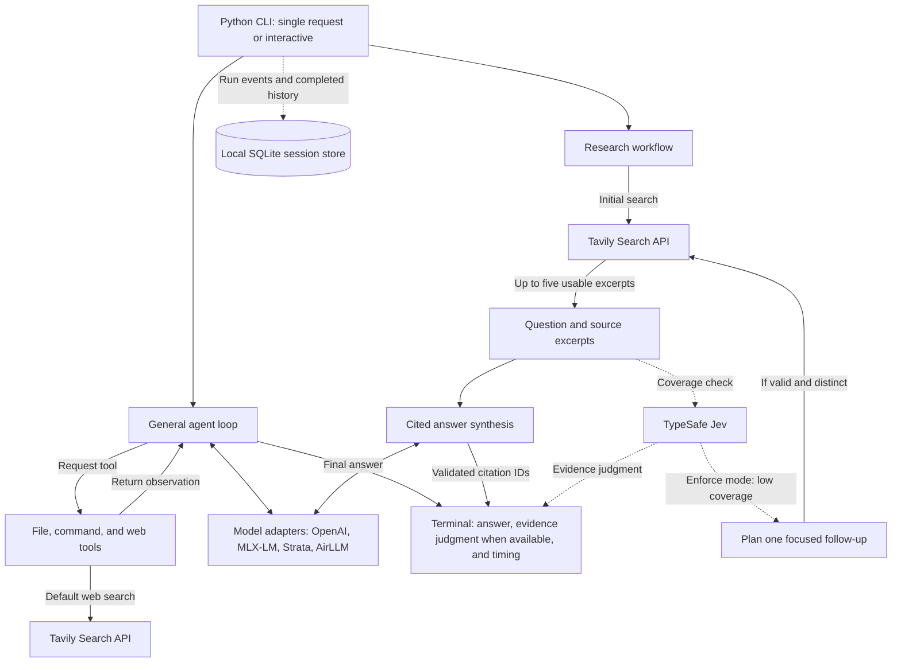

# Inquiry Loop — Research and Tool-Using CLI


Inquiry Loop is a Python command-line agent for experimenting with local and hosted language models, tool calling, and cited web research. It records model responses, tool calls, and evidence judgments in SQLite. A separate [incident benchmark suite](#incident-runbook-benchmarks) evaluates cited diagnoses, abstention, and inference performance on public Kubernetes runbooks and synthetic incidents.

## Overview

The CLI offers two workflows. The **general agent** follows a propose → execute → observe loop for tasks such as reading files, searching source code, and looking up web sources. **Research mode** searches Tavily and asks the selected LLM for a cited answer. TypeSafe Jev assesses evidence coverage in shadow mode by default; opt-in enforcement can use that judgment to run one focused follow-up search. Both workflows share the model adapters and session store.

## Key Features

- **Interchangeable model backends.** Run OpenAI, MLX-LM, Strata, or experimental AirLLM through the same CLI. A scripted stub demonstrates the tool loop offline.
- **File and web tools.** List directories, inspect paginated UTF-8 files, find literal matches, write files, run allowlisted commands, or search the web.
- **Cited research.** Validate citation IDs against the retrieved links and display Jev’s evidence judgments. Enforcement can add up to five excerpts from one additional search.
- **Interactive sessions.** Keep one model loaded, switch into research mode with `/research`, and resume completed conversations from SQLite.
- **Run metrics and evaluation.** Inspect elapsed time, model-call counts, token throughput, and Jev judgments. Replay frozen incident cases to compare retrieval, diagnosis quality, and local versus hosted inference.

## System Architecture



The Python application controls tool execution and request budgets. Research uses one Tavily search in `off` and `shadow` modes; in `enforce` mode Python can authorize one additional search, never a loop. Tavily and TypeSafe are called through their HTTP APIs, not MCP.

## Repository Layout

| File | Role |
| --- | --- |
| [`agent.py`](agent.py) | CLI, general agent loop, tool definitions, and backend selection |
| [`research.py`](research.py) | Research workflow, citation validation, and evidence display |
| [`web_search.py`](web_search.py), [`jev_eng.py`](jev_eng.py) | Search providers and the TypeSafe evidence-check client |
| [`openai_eng.py`](openai_eng.py), [`mlx_eng.py`](mlx_eng.py), [`strata_eng.py`](strata_eng.py), [`airllm_eng.py`](airllm_eng.py), [`stub_eng.py`](stub_eng.py) | Model adapters and the offline stub |
| [`response_types.py`](response_types.py), [`request_metrics.py`](request_metrics.py) | Shared response types and token-throughput reporting |
| [`session_store.py`](session_store.py) | SQLite sessions, execution events, checkpoints, and process locks |
| [`benchmark_search.py`](benchmark_search.py), [`benchmark_research.py`](benchmark_research.py), [`research_cases.py`](research_cases.py) | Search-provider comparison and labeled evidence evaluation |
| [`benchmark_incidents.py`](benchmark_incidents.py), [`incident_retrieval.py`](incident_retrieval.py) | Offline keyword and hybrid retrieval on frozen incident evidence |
| [`benchmark_diagnosis.py`](benchmark_diagnosis.py), [`incident_diagnosis.py`](incident_diagnosis.py), [`incident_grading.py`](incident_grading.py) | Cited diagnosis, bounded read-only lookup, and separate evidence, correctness, and abstention grades |
| [`benchmark_inference.py`](benchmark_inference.py), [`benchmark_grounding.py`](benchmark_grounding.py), [`incident_grounding.py`](incident_grounding.py) | MLX versus hosted inference and the optional grounding pilot |
| [`test_*.py`](#tests-and-evaluation) | Regression tests for tools, research, sessions, model adapters, and benchmarks |

## Setup

Use Python 3.11 or newer for the full dependency set. Run the commands from the project directory. The offline stub needs only Python and works without credentials.

```bash
python3 agent.py --stub --no-trace "List the files here"
```

For a real backend, create a virtual environment and install the [project dependencies](requirements.txt). On initial setup, copy the example configuration. If `.env` already exists, edit it in place.

```bash
python3 -m venv .venv
source .venv/bin/activate
python3 -m pip install -r requirements.txt
cp .env.example .env
```

| Setting | Used by |
| --- | --- |
| `OPENAI_API_KEY` | OpenAI model requests. `AGENT_MODEL` overrides the default `gpt-4o-mini`. |
| `TAVILY_API_KEY` | Ranked web search in the general agent and in research mode. |
| `TYPESAFE_API_KEY` | Jev evidence checks. `JEV_MODEL` selects a model version and defaults to `jev-latest`. |

Set credentials in `.env` or in the environment. Existing environment variables take precedence. `.env` and the default `.agent/` trace directory are ignored by Git. Keep [`.env.example`](.env.example) limited to placeholders.

## CLI

### General Agent

```bash
python3 agent.py "List the files here and summarize requirements.txt"
python3 agent.py --llm=mlx --interactive
```

The general agent can use `list_dir`, `read_file`, `search_file`, `write_file`, `run_shell`, and `search_web`. File reads return a continuation offset for large files. The CLI reports partial inspection when the recorded reads leave gaps. `run_shell` launches an allowlisted executable directly with output and time limits. The default run budget is 16 model responses, including the final answer. Use `--max-steps` to change it.

To check search by itself or ask the general agent for sources, run:

```bash
python3 -c 'from web_search import search_web; print(search_web("Python asyncio Queue shutdown documentation", max_results=3))'
python3 agent.py "Find the official Python asyncio Queue.shutdown documentation and cite its URL."
```

### Research Mode

```bash
python3 agent.py --research 'Which gpt-oss models did OpenAI announce in August 2025, and under what license?'
```

In an interactive session, type `/research` and then enter a standalone public question. Each question can be up to 400 characters and 50 words. Research turns stay in the active session. Enter `/new` to start a fresh session in the general agent mode.

```text
You> /research
You> What is the capital of Canada?
```

Jev shadow checking runs by default. A line such as `Jev evidence check (shadow) — supported (72%, jev-1.14.0)` appears below the answer. The percentage is Jev’s probability for the evidence-coverage label, not the probability that the answer is correct. Use `--research --evidence-check off` or interactive `/research off` to skip Jev.

To opt into one focused follow-up search:

```bash
python3 agent.py --research --evidence-check enforce --evidence-threshold 0.60 \
  'Which gpt-oss models were announced, and when did they become available?'
```

In an interactive session, use `/research enforce` or `/research enforce 0.65`. The provisional cutoff is `0.60` unless overridden. Enforcement considers a follow-up when Jev returns `partial`, `insufficient`, `supported` below the cutoff, or when Tavily returns no usable excerpts. The model proposes one query targeting the evidence gap. Python rejects invalid or repeated queries, merges up to five new usable excerpts without duplicating URLs, and rechecks only if usable evidence was added. The CLI shows why it searched again and any available before-and-after judgments. The synthesis prompt asks the model to separate supported findings from what remains unresolved.

A Jev error alone never triggers a search; coverage is reported as unassessed. An unsuccessful follow-up leaves the initial excerpts available. Enforcement is capped at two searches, two Jev checks, and two LLM calls. With `--max-steps 1`, it reserves the single model call for the answer. Enforcement is not yet validated to improve citation support on held-out questions; see the [Jev research plan](JEV_RESEARCH_PLAN.md).

### Interactive Sessions

Use the Left and Right arrow keys to move within a question before submitting it. This works in a terminal when Python has `readline` support.

| Command | Behavior |
| --- | --- |
| `/research [off\|shadow\|enforce [threshold]]` | Switch to research in the current session. With no argument, use `shadow`. |
| `/new` | Start a clean session in the general agent mode while keeping the model loaded. |
| `/sessions` | List saved sessions and backend identities. |
| `/resume ID` | Restore a completed conversation checkpoint using a full session ID or unique prefix. |
| `/stats [ID]` | Inspect run statuses, durations, model calls, and token throughput. |
| `/help`, `/quit` | List commands or exit. |

The default database is `.agent/sessions.sqlite3`. Use `--db PATH` to choose another location or `--no-trace` to work without persistence. With tracing disabled, `/research` and `/new` still switch modes. Resume requires the original backend, model identity, and working directory. It restores the last completed checkpoint without replaying tool calls.

Each run’s timing summary starts with the selected backend (for example, `mlx processed request in …`) and reports elapsed time and tokens per second when available. Interactive mode reports model initialization separately. Local decode speed and API request throughput use different timing bases.

## Model Backends

| Backend | Run command | Setup |
| --- | --- | --- |
| **OpenAI** | `python3 agent.py --llm=openai -i` | Set `OPENAI_API_KEY`. This is the default backend. |
| **MLX-LM** | `python3 agent.py --llm=mlx -i` | Apple Silicon with compatible MLX weights and a tokenizer that supports native tool calls. Use `--model` for a model repository or `--model-path` for a local directory. |
| **Strata** | `python3 agent.py --llm=strata -i` | Start Strata and load a model. Copy the serving URL and model ID from its Serving screen. |
| **AirLLM** | `python3 agent.py --llm=airllm --model-path /path/to/Qwen3-snapshot -i` | Experimental Apple Silicon backend. Install compatible AirLLM and MLX packages separately and supply a local dense Qwen3 snapshot. |
| **Offline stub** | `python3 agent.py --stub --no-trace` | Runs a fixed file-tool demonstration with Python’s standard library. |

For MLX, set `MLX_MODEL` in `.env` or select a model on the command line. The built-in fallback is `mlx-community/Qwen3-4B-4bit`. The example config selects `mlx-community/Qwen3-30B-A3B-Instruct-2507-4bit`. First use may download the selected weights, which are kept in the Hugging Face cache. `MLX_MAX_TOKENS` and `MLX_MAX_CONTEXT_TOKENS` control output and total context. The prompt must fit within the context after reserving the output budget.

For Strata, set `STRATA_BASE_URL` and `STRATA_MODEL` in `.env`, or pass `--base-url` and `--model`. The default endpoint is `http://127.0.0.1:8080/v1`, and the client automatically selects the model when the server lists exactly one. Set `STRATA_API_KEY` if the server requires it. `STRATA_MAX_TOKENS` sets the output budget. See the [Strata integration notes](STRATA_BACKEND_PLAN.md) for details.

## Tests and Evaluation

```bash
python3 -m unittest discover -v
python3 -m unittest test_research test_research_enforcement test_search test_benchmark_search -v
```

The regression suite uses mocks for provider calls and model generation. The optional MLX chat-template check uses Jinja2 (`python3 -m pip install Jinja2`) and a cached Qwen3-4B tokenizer. The project has been exercised with live OpenAI, MLX, Strata, Tavily, and TypeSafe integrations. AirLLM remains experimental.

```bash
# Evaluate Tavily results on 20 public queries.
python3 benchmark_search.py --provider tavily > tavily-search-report.json

# Replay labeled evidence cases without a provider call.
python3 benchmark_research.py

# Replay one public case against Jev using the configured TypeSafe key.
python3 benchmark_research.py --live --case gpt-names
```

For the Tavily benchmark, mark `useful_top_5` for each query, then run `python3 benchmark_search.py --score tavily-search-report.json`. The research benchmark measures label agreement, false `supported` judgments, and latency on frozen excerpts. Jev matched all 18 judged cases in the initial pilot, skipped two empty cases, and had a median latency of 195 ms. A proposed 75% cutoff would have triggered extra searches for four of five adequately supported held-out cases. See the [Jev research plan](JEV_RESEARCH_PLAN.md#first-milestone-results) for the dataset and evaluation details.

### Incident Runbook Benchmarks

These are separate evaluation scripts, not a mode in `agent.py`. The incident workflow explains synthetic incidents from cited evidence; it does not query clusters or run remediation. All four evaluation milestones are complete. **Citation verification is off by default** and runs only in the verified arm of the grounding benchmark. It is separate from Jev’s shadow check in web research.

| Evaluation | Result | Artifacts |
| --- | --- | --- |
| **Retrieval** | On 12 answerable held-out cases, BM25 scored **80.56% Recall@5** and hybrid **83.33%**. Both recovered all labeled passages in 7/12; four insufficient cases were reported separately. | [Method and setup](INCIDENT_RUNBOOK_PLAN.md#milestone-1-results) · [Report](incident_retrieval_report.json) |
| **Cited diagnosis** | The fixed and bounded read-only workflows each scored **10/16 fully correct**. The lookup added observations in three cases without improving that total. Citation support, conclusion correctness, and abstention were graded separately. | [Trace analysis](INCIDENT_RUNBOOK_PLAN.md#milestone-2-results) · [Report](incident_diagnosis_report.json) |
| **Local vs. hosted inference** | On the same 16 cases per condition, warm MLX and OpenAI median times to first text were **5.22 s** and **0.50 s**; median end-to-end times were **9.49 s** and **1.69 s**. Warm fully correct counts were **4/16** and **10/16**. MLX peaked at **2.94 GiB of allocator memory** on the 32 GiB M1 Pro. Estimated OpenAI cost was **$0.00772** for 32 measured requests, excluding priming. | [Cold and warm results, settings, and workload guidance](INCIDENT_RUNBOOK_PLAN.md#milestone-3-results) · [Report](incident_inference_report.json) |
| **Citation verification pilot** | On 10 fresh cases, unsupported conclusions fell from **7/16 to 6/15** and fully correct runs rose from **3/10 to 4/10**, with no unnecessary abstentions in either arm. Median latency rose from **2.30 s to 5.49 s**. The pilot did not justify enabling verification by default. | [Analysis](INCIDENT_RUNBOOK_PLAN.md#milestone-4-results) · [Report](incident_grounding_report.json) |

To regrade the published diagnosis and grounding results without model calls or credentials:

```bash
python3 benchmark_diagnosis.py grade incident_diagnosis_report.json incident_diagnosis_reviews.json
python3 benchmark_grounding.py grade incident_grounding_report.json incident_grounding_reviews.json
```

See [MILESTONES.md](MILESTONES.md) for acceptance criteria and the [incident plan](INCIDENT_RUNBOOK_PLAN.md) for live replay commands. Offline retrieval requires SQLite FTS5 and a one-time download of pinned embedding weights. Local inference requires an Apple Silicon terminal with Metal access and the pinned MLX snapshot; hosted replay requires an OpenAI API key and incurs token charges. New inference runs need fresh semantic reviews.

## Scope and Data Handling

The general agent’s file tools operate with the running user’s permissions. They can access paths outside the project and overwrite existing files. Use a dedicated working directory or an OS sandbox if you need to limit that access.

With hosted inference, tool observations can be sent to the configured provider. MLX, AirLLM, and a local Strata endpoint keep model execution on your machine, but using Tavily or Jev still makes network requests: Tavily receives web queries, and TypeSafe receives the public research question and excerpts when Jev is enabled. Hosted incident benchmarks send only public runbook excerpts and synthetic case evidence. SQLite traces can retain requests, excerpts, tool output, and answers.

## Author

Gordon Pusnik
