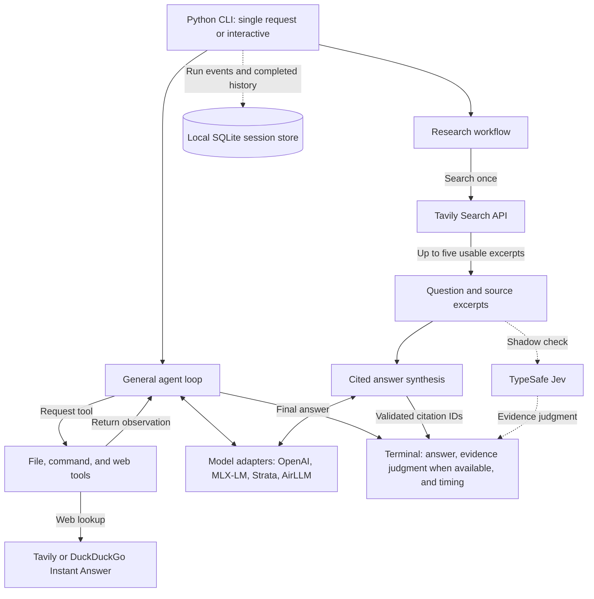

# Inquiry Loop — Research and Tool-Using CLI


Inquiry Loop is a Python command-line agent for experimenting with local and cloud language models, tool calling, and evidence-based web research. It saves model responses, tool calls, and research judgments to SQLite so you can inspect how a run reached its answer.

## Overview

The CLI offers two workflows. The **general agent** follows a propose → execute → observe loop for tasks such as reading files, searching source code, and looking up web sources. **Research mode** performs one Tavily search, asks TypeSafe Jev whether the excerpts cover the question, and has the selected LLM write a cited answer. Both workflows share the model adapters and session store.

## Key Features

- **Interchangeable model backends.** Run OpenAI, MLX-LM, Strata, or experimental AirLLM through the same CLI. A scripted stub demonstrates the tool loop offline.
- **File and web tools.** List directories, inspect paginated UTF-8 files, find literal matches, write files, run allowlisted commands, or search the web.
- **Cited research.** Use up to five Tavily excerpts, validate source references against the retrieved links, and display Jev’s evidence judgment alongside the answer.
- **Interactive sessions.** Keep one model loaded, switch into research mode with `/research`, and resume completed conversations from SQLite.
- **Run metrics and evaluation.** Inspect elapsed time, model-call counts, token throughput, and Jev judgments. Replay labeled cases to see where a decision threshold would trigger another search.

## System Architecture



The Python application controls tool execution and the general agent’s response budget. In research mode, Jev judges the excerpts before synthesis and its result is displayed and traced. The selected language model writes the answer from the excerpts. The research workflow performs one search regardless of the judgment.

## Repository Layout

| File | Role |
| --- | --- |
| [`agent.py`](agent.py) | CLI, general agent loop, tool definitions, and backend selection |
| [`research.py`](research.py) | Research workflow, citation validation, and evidence display |
| [`web_search.py`](web_search.py), [`jev_eng.py`](jev_eng.py) | Search providers and the TypeSafe evidence-check client |
| [`openai_eng.py`](openai_eng.py), [`mlx_eng.py`](mlx_eng.py), [`strata_eng.py`](strata_eng.py), [`airllm_eng.py`](airllm_eng.py), [`stub_eng.py`](stub_eng.py) | Model adapters and the offline stub |
| [`response_types.py`](response_types.py), [`request_metrics.py`](request_metrics.py) | Shared response types and token-throughput reporting |
| [`session_store.py`](session_store.py) | SQLite sessions, execution events, checkpoints, and process locks |
| [`benchmark_search.py`](benchmark_search.py), [`benchmark_research.py`](benchmark_research.py), [`research_cases.py`](research_cases.py) | Search-provider comparison and labeled evidence evaluation |
| [`test_*.py`](#tests-and-evaluation) | Regression tests for tools, research, sessions, and model adapters |

## Setup

Use Python 3.11 or newer for the full dependency set. Run the commands from the project directory. The offline stub needs only Python and works without credentials.

```bash
python3 agent.py --stub --no-trace "List the files here"
```

For a real backend, create a virtual environment and install the [project dependencies](requirements.txt). On initial setup, copy the example configuration. If `.env` already exists, edit it in place.

```bash
python3 -m venv .venv
source .venv/bin/activate
python3 -m pip install -r requirements.txt
cp .env.example .env
```

| Setting | Used by |
| --- | --- |
| `OPENAI_API_KEY` | OpenAI model requests. `AGENT_MODEL` overrides the default `gpt-4o-mini`. |
| `TAVILY_API_KEY` | Ranked web search and research mode. For general-agent lookups, `SEARCH_PROVIDER=instant-answer` selects DuckDuckGo’s limited keyless Instant Answer API. |
| `TYPESAFE_API_KEY` | Jev evidence checks. `JEV_MODEL` selects a model version and defaults to `jev-latest`. |

Set credentials in `.env` or in the environment. Existing environment variables take precedence. `.env` and the default `.agent/` trace directory are ignored by Git. Keep [`.env.example`](.env.example) limited to placeholders.

## CLI

### General Agent

```bash
python3 agent.py "List the files here and summarize requirements.txt"
python3 agent.py --llm=mlx --interactive
```

The general agent can use `list_dir`, `read_file`, `search_file`, `write_file`, `run_shell`, and `search_web`. File reads return a continuation offset for large files. The CLI reports partial inspection when the recorded reads leave gaps. `run_shell` launches an allowlisted executable directly with output and time limits. The default run budget is 16 model responses, including the final answer. Use `--max-steps` to change it.

To check search by itself or ask the general agent for sources, run:

```bash
python3 -c 'from web_search import search_web; print(search_web("Python asyncio Queue shutdown documentation", max_results=3))'
python3 agent.py "Find the official Python asyncio Queue.shutdown documentation and cite its URL."
```

### Research Mode

```bash
python3 agent.py --research 'Which gpt-oss models did OpenAI announce in August 2025, and under what license?'
```

In an interactive session, type `/research` and then enter a standalone public question. Each question can be up to 400 characters and 50 words. Research turns stay in the active session. Enter `/new` to start a fresh session in the general agent mode.

```text
You> /research
You> What is the capital of Canada?
```

Jev shadow checking runs by default. A line such as `Jev evidence check (shadow) — supported (72%, jev-1.14.0)` appears below the answer and before the timing summary. The percentage is the probability Jev assigned to the `supported` evidence label. The LLM’s final answer is generated after this check. For a one-shot comparison that skips Jev, use `--research --evidence-check off`.

### Interactive Sessions

| Command | Behavior |
| --- | --- |
| `/research` | Switch to research with Jev in the current session. |
| `/new` | Start a clean session in the general agent mode while keeping the model loaded. |
| `/sessions` | List saved sessions and backend identities. |
| `/resume ID` | Restore a completed conversation checkpoint using a full session ID or unique prefix. |
| `/stats [ID]` | Inspect run statuses, durations, model calls, and token throughput. |
| `/help`, `/quit` | List commands or exit. |

The default database is `.agent/sessions.sqlite3`. Use `--db PATH` to choose another location or `--no-trace` to work without persistence. With tracing disabled, `/research` and `/new` still switch modes. Resume requires the original backend, model identity, and working directory. It restores the last completed checkpoint without replaying tool calls.

Each run reports elapsed time and, where the backend supplies usable timing data, tokens per second. Interactive mode reports model initialization separately from request timing. Local decode speed and API request throughput use different timing bases.

## Model Backends

| Backend | Run command | Setup |
| --- | --- | --- |
| **OpenAI** | `python3 agent.py --llm=openai -i` | Set `OPENAI_API_KEY`. This is the default backend. |
| **MLX-LM** | `python3 agent.py --llm=mlx -i` | Apple Silicon with compatible MLX weights and a tokenizer that supports native tool calls. Use `--model` for a model repository or `--model-path` for a local directory. |
| **Strata** | `python3 agent.py --llm=strata -i` | Start Strata and load a model. Copy the serving URL and model ID from its Serving screen. |
| **AirLLM** | `python3 agent.py --llm=airllm --model-path /path/to/Qwen3-snapshot -i` | Experimental Apple Silicon backend. Install compatible AirLLM and MLX packages separately and supply a local dense Qwen3 snapshot. |
| **Offline stub** | `python3 agent.py --stub --no-trace` | Runs a fixed file-tool demonstration with Python’s standard library. |

For MLX, set `MLX_MODEL` in `.env` or select a model on the command line. The built-in fallback is `mlx-community/Qwen3-4B-4bit`. The example config selects `mlx-community/Qwen3-30B-A3B-Instruct-2507-4bit`. First use may download the selected weights, which are kept in the Hugging Face cache. `MLX_MAX_TOKENS` and `MLX_MAX_CONTEXT_TOKENS` control output and total context. The prompt must fit within the context after reserving the output budget.

For Strata, set `STRATA_BASE_URL` and `STRATA_MODEL` in `.env`, or pass `--base-url` and `--model`. The default endpoint is `http://127.0.0.1:8080/v1`, and the client automatically selects the model when the server lists exactly one. Set `STRATA_API_KEY` if the server requires it. `STRATA_MAX_TOKENS` sets the output budget. See the [Strata integration notes](STRATA_BACKEND_PLAN.md) for details.

## Tests and Evaluation

```bash
python3 -m unittest discover -v
python3 -m unittest test_research test_search test_benchmark_search -v
```

The regression suite uses mocks for provider calls and model generation. The optional MLX chat-template check uses Jinja2 (`python3 -m pip install Jinja2`) and a cached Qwen3-4B tokenizer. The project has been exercised with live OpenAI, MLX, Strata, Tavily, and TypeSafe integrations. AirLLM remains experimental.

```bash
# Compare Tavily and DuckDuckGo Instant Answer on 20 public queries.
python3 benchmark_search.py > search-comparison.json

# Replay labeled evidence cases without a provider call.
python3 benchmark_research.py

# Replay one public case against Jev using the configured TypeSafe key.
python3 benchmark_research.py --live --case gpt-names
```

For the search comparison, mark `useful_top_5` for each query and provider, then run `python3 benchmark_search.py --score search-comparison.json`. The research benchmark measures label agreement, false `supported` judgments, and latency on frozen excerpts. Jev matched all 18 judged cases in the initial pilot, skipped two empty cases, and had a median latency of 195 ms. A proposed 75% cutoff would have triggered extra searches for four of five adequately supported held-out cases. See the [Jev research plan](JEV_RESEARCH_PLAN.md#first-milestone-results) for the dataset and evaluation details.

## Scope and Data Handling

The general agent’s file tools operate with the running user’s permissions. They can access paths outside the project and overwrite existing files. Use a dedicated working directory or an OS sandbox if you need to limit that access.

With cloud inference, tool observations can be sent to the configured model provider. Local inference keeps model execution on your machine when you use MLX, AirLLM, or a local Strata endpoint. Tavily receives web queries. TypeSafe receives the public research question and excerpts when Jev is enabled. SQLite traces can retain requests, excerpts, tool output, and answers.

## Author

Gordon Pusnik
