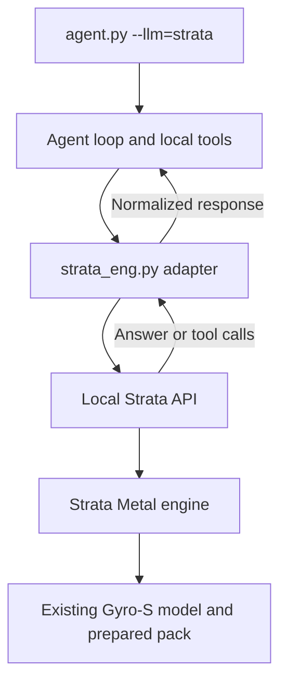

# Strata local LLM backend: investigation and implementation plan

Status: backend and CLI implemented; 31 automated tests pass. Live Strata verification and memory measurements remain pending.

## Implementation record

- Added `strata_eng.py` with native tool calls, model discovery, isolated local credentials/URL, bounded output, disabled automatic retries, and explicit response/error checks.
- Added `--llm=strata`, `--base-url`, and `--model`; preserved the OpenAI default, AirLLM, and offline stub.
- Added nine SDK-mocked Strata tests, including two tool turns using temporary files; all 31 project tests pass.
- Updated README setup, configuration, and the Mermaid flow.
- Package downloads and localhost requests are blocked in the development environment. Real SDK HTTP behavior, live model/tool-loop compatibility, performance, and memory pressure have not been verified. No additional Strata engine was started or model copy loaded.
- The remaining sections retain the original design and acceptance criteria; the code and CLI steps are implemented, while the live checks and optional headless-server workflow remain pending.

## Findings

The inspected Strata checkout is `/Users/gordpusnik/Home/Projects/strata`, remote `https://github.com/Niko1221/Strata.git`, commit `13eedf55`.

| Item | Finding |
| --- | --- |
| Downloaded model | `/Users/gordpusnik/Documents/Strata/Models/gyro-Gyro-S/Qwen3.8-Flash-Next-Gyro-S-TQ1_0.gguf` |
| File size | 58,487,015,808 bytes: approximately 58.5 GB or 54.5 GiB on disk. This is not its resident RAM requirement. |
| Metadata | GGUF v3; name `Qwen3.8-Flash-Next Gyro-S`; architecture `qwen4exp`; 48 blocks, 512 routed experts per block, 10 selected per token per block. Header read only; weights were not loaded. |
| Quantization | Gyro trellis-coded expert weights. The filename's `TQ1_0` is a size label; Strata documents TQK6/TQK7 expert types for Gyro-S. |
| Prepared data | `packs/gyro-gyro-s` contains the generated index, dense weights, expert offsets, and Hadamard metadata. Conversion metadata identifies the same GGUF source. |
| Mac runtime | Strata's own C++/Objective-C++ Metal engine, built from `metal/` and shared host code. It uses parts of llama.cpp/ggml; this is not the AirLLM/MLX runtime. |
| API | The Python server supports OpenAI Chat Completions at `/v1/chat/completions` and model discovery at `/v1/models`, including native tool-call responses. |
| Engine licensing | Strata is MIT licensed. Vendored ggml is MIT licensed. Model weights have a separate license. |
| Model licensing | The publisher identifies Qwen Community License 1.0 for this model. It should not be described as MIT-licensed model weights. |

Strata's Mac documentation describes SSD streaming of experts when the selected pack cannot remain resident. It keeps frequently used experts in a bounded memory arena, reads others as needed, and reads the model's n-gram table from SSD. Its specialized quantization and memory strategy explain why this is a promising alternative to loading a dense Qwen3 model through AirLLM. The user's successful app run is useful evidence, but no equivalent agent workload or memory benchmark was run in this investigation.

The Mac documentation estimates about 38 GB for a fully resident Gyro-S configuration and says it streams below the recommended 48 GB tier. These are documentation estimates, not a measurement of this Mac. GGUF's advertised 262,144-token context is also not a recommendation for the application's configured context.

The installed app's exact active engine version, endpoint, model ID, context, and draft settings were not verified. Requests to the conventional `127.0.0.1:8080` endpoint were blocked by this execution environment (`Operation not permitted`), so this does not establish whether the server is running. The desktop app's Serving screen supplies its actual API base URL and model ID; its port can differ from the terminal server default.

## Recommended design

Add `strata_eng.py` containing `StrataModel`, implementing the existing `respond(messages) -> (tool_calls, text)` interface. Connect to Strata's local OpenAI-compatible server using the already-required OpenAI Python SDK. Here the SDK is an HTTP client for a local engine; inference does not go to OpenAI.

Keep OpenAI as the default and retain AirLLM and the offline stub. The agent continues to own and execute its tools. Strata handles model templates, tokenization, native tool-call parsing, Metal inference, model memory, and caching. The new backend must not load a second copy of the weights.



Using the existing API preserves the runtime that already works. Generic llama.cpp or llama-cpp-python compatibility cannot be assumed for these specialized Gyro expert types simply because the file is GGUF.

## Implementation steps

### 1. Verify the existing local service

- Obtain the API base URL and model ID from Strata's Serving screen, or enumerate `/v1/models` when the endpoint is reachable.
- Reuse the loaded Gyro-S model and its existing working memory settings.
- Test one short completion, then one declared `list_dir` tool call and a tool-result follow-up. Plain chat success alone does not validate agent integration.
- Record the running server version, configured context, and reasoning settings. Avoid starting another engine alongside the desktop app.

Acceptance: the server returns an ordinary assistant response and a structured tool call with valid JSON arguments, followed by a final answer after receiving the tool observation.

### 2. Add the backend adapter

- Create `strata_eng.py` with lazy SDK initialization and injected tool schemas. Do not import Strata's Python source tree into our agent.
- Support `STRATA_BASE_URL`, `STRATA_MODEL`, and optional `STRATA_API_KEY`; use a local placeholder credential only when the local server requires no key. Do not reuse the OpenAI cloud API key.
- Use the configured local base URL explicitly; default to `http://127.0.0.1:8080/v1` for the conventional server, while allowing the app's actual address to override it. Never fall back to a cloud endpoint.
- Use an explicitly selected model, or discover it when exactly one is available. Report an actionable error for no models or ambiguous model selection.
- Send native `messages`, `tools`, `tool_choice="auto"`, and non-streaming requests. Request one tool at a time and verify how the installed server handles `parallel_tool_calls=False`.
- Return native tool-call objects through the existing agent interface. Preserve call IDs and tool-result messages. Do not add the AirLLM JSON decision protocol to this backend.
- Configure a bounded output budget and request timeout; disable automatic retries initially. Detect token-limit truncation, malformed responses, missing models, authentication errors, and connection failures explicitly.
- Start with reasoning disabled via supported Strata chat-template options for the first tool-loop test. Make the setting configurable if needed after verifying the installed API behavior.

Acceptance: the adapter completes a mocked tool round trip, uses only its configured endpoint/credential, and makes no GPU allocations or model downloads in the agent process.

### 3. Extend the command line

- Add `strata` to `--llm` choices and its factory branch.
- Add `--base-url` and `--model` overrides for Strata. Preserve `--model-path` for AirLLM; reject irrelevant combinations clearly.
- Keep the default OpenAI behavior and `--stub` behavior intact.

Target usage after implementation:

```bash
python3 agent.py --llm=strata "List the files here and summarize README.md"
python3 agent.py --llm=strata --base-url http://127.0.0.1:8080/v1 --model MODEL_ID "Your task"
```

`MODEL_ID` is the ID exposed by the running server, not a filesystem path. These commands now select the implemented backend; they require a running Strata server.

### 4. Test and document

- Add mocked tests for CLI selection, endpoint and credential isolation, model discovery, tool calls, tool-result feedback, final answers, connection/authentication failures, and truncated output.
- Run the existing suite to preserve OpenAI, AirLLM, search, and stub functionality.
- Run a local smoke test that lists a temporary directory, reads a known small file, and answers from the observed content. Include more than one tool turn.
- Measure process memory, system memory pressure, time to first token, and overall task time across repeated turns with the existing model. Keep concurrency at one and do not increase the context just because the model advertises a large maximum.
- Update README with backend selection, server startup/connection instructions, model reuse, configuration, and verified runtime limits.

Acceptance: the agent completes the smoke task through the existing Strata runtime without a duplicate model load or an out-of-memory failure. If memory grows across turns, investigate context and Strata session/cache settings before raising budgets.

### 5. Optional independent server operation

Once attaching to the app works, document starting Strata's terminal/headless service against the same downloaded files and prepared pack. This allows use without the desktop UI. Confirm the existing configuration and engine binary before choosing a launch command; starting `serve.server` without its prepared run configuration is insufficient.

Automatic server startup/shutdown or embedding the native runtime is a later scope. A separately managed local Strata service is enough for the first integration and retains its working memory management.

## Sources

Local evidence:

- Strata `LICENSE`, `metal/CMakeLists.txt`, and `third_party/strata-ggml/LICENSE`.
- Strata `docs/MAC.md`, `docs/GYRO.md`, `docs/HOW_IT_WORKS.md`, and `docs/TERMINAL_LAUNCH.md`.
- Strata `serve/server.py`, `serve/test_tool_routes.py`, `serve/test_history_tools.py`, and `apps/host/src/screens/Serving.tsx`.
- Downloaded GGUF header and `packs/gyro-gyro-s/{conversions.json,index.txt,native_experts.txt}`.

Publisher references:

- [Strata source and license](https://github.com/Niko1221/Strata).
- [Strata Mac runtime](https://github.com/Niko1221/Strata/blob/main/docs/MAC.md).
- [Strata API reference](https://github.com/Niko1221/Strata/blob/main/docs/AI_REFERENCE.md).
- [Gyro model card and license](https://huggingface.co/agentionai/Qwen3.8-Flash-Next-Gyro-GGUF).
