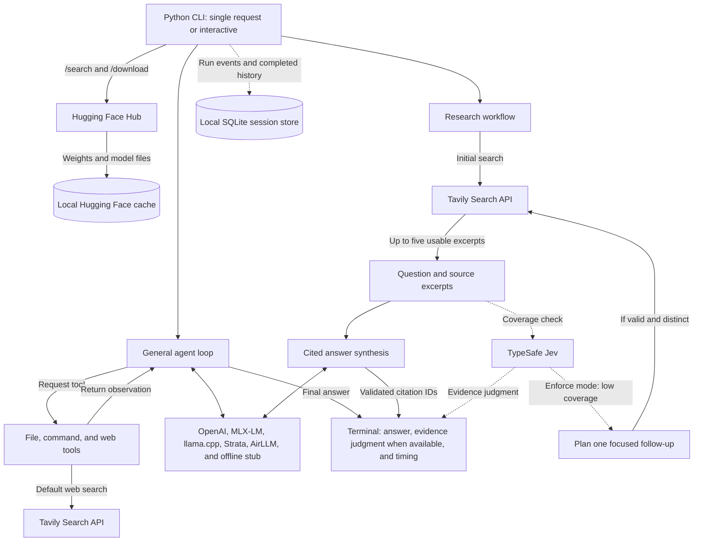

# Architecture

The CLI offers two inference workflows. The **general agent** follows a propose → execute → observe loop for tasks such as reading files, searching source code, and looking up web sources. **Research mode** searches Tavily and asks the selected LLM for a cited answer. TypeSafe Jev assesses evidence coverage in shadow mode by default; opt-in enforcement can use that judgment to run one focused follow-up search. Both workflows share the model adapters and session store.

The Python application controls tool execution and request budgets. Research uses one Tavily search in `off` and `shadow` modes; in `enforce` mode Python can authorize one additional search, never a loop. Only the general agent executes model tool calls. Research validates citation IDs against the retained links; it does not verify that each link supports the claim. Tavily and TypeSafe are called through HTTP APIs, not MCP.

The llama.cpp adapter starts a loopback server for the selected GGUF, sends chat completions to it, and stops the process when the session closes. The shared agent loop executes any tools the model requests. [llama.cpp setup](cli.md#local-gguf-models-with-llamacpp)

The interactive `/search` and `/download` commands call Hugging Face through its SDK. They operate independently of the loaded model and write downloads to the shared Hugging Face cache. [Model discovery and downloads](cli.md#find-and-download-models)

## Repository layout

| Path | Role |
| --- | --- |
| [`agent.py`](../agent.py) | Root launcher; use `python3 agent.py`. |
| [`inquiry_loop/cli.py`](../inquiry_loop/cli.py), [`inquiry_loop/agent.py`](../inquiry_loop/agent.py) | Argument parsing, backend selection, interactive sessions, and the general agent loop and tools. |
| [`inquiry_loop/engine.py`](../inquiry_loop/engine.py) | Shared backend construction and tool-free text chat for product callers. |
| [`inquiry_loop/research.py`](../inquiry_loop/research.py) | Bounded search and cited synthesis, with optional Jev evidence checks. |
| [`inquiry_loop/request_metrics.py`](../inquiry_loop/request_metrics.py), [`inquiry_loop/response_types.py`](../inquiry_loop/response_types.py) | Token-throughput reporting and shared model response types. |
| [`inquiry_loop/session_store.py`](../inquiry_loop/session_store.py), [`inquiry_loop/paths.py`](../inquiry_loop/paths.py) | SQLite sessions, execution events, checkpoints and process locks; shared repository paths. `.env` and `.agent/` stay at the root. |
| [`inquiry_loop/backends/`](../inquiry_loop/backends/) | Model adapters for OpenAI, MLX-LM, llama.cpp, Strata, AirLLM, and the offline stub. |
| [`inquiry_loop/providers/web_search.py`](../inquiry_loop/providers/web_search.py), [`inquiry_loop/providers/jev_eng.py`](../inquiry_loop/providers/jev_eng.py) | Ranked and keyless search providers, and the TypeSafe Jev client. |
| [`inquiry_loop/providers/hub_models.py`](../inquiry_loop/providers/hub_models.py) | Hugging Face model search and downloads for the interactive CLI. |
| [`inquiry_loop/incidents/`](../inquiry_loop/incidents/) | Offline `incident_retrieval.py`, cited explanations and bounded lookups in `incident_diagnosis.py`, separate grades in `incident_grading.py`, and the optional verifier in `incident_grounding.py`. |
| [`benchmarks/`](../benchmarks/) | Benchmark modules and `requirements.txt` for optional retrieval dependencies. Frozen incident JSON and `research_cases.py` are in [`fixtures/`](../benchmarks/fixtures/); recorded `*_report.json` and `*_reviews.json` are in [`results/`](../benchmarks/results/). |
| [`tests/`](../tests/) | Regression tests for tools, research, sessions, model adapters, and benchmarks. |

The incident workflows are benchmark-only: they replay frozen evidence, not live incidents. See the [benchmark guide](benchmarks.md) for module entry points and results.

See the [product architecture and milestones](../PRODUCT_MILESTONES.md) for the FastAPI service and worker design.
